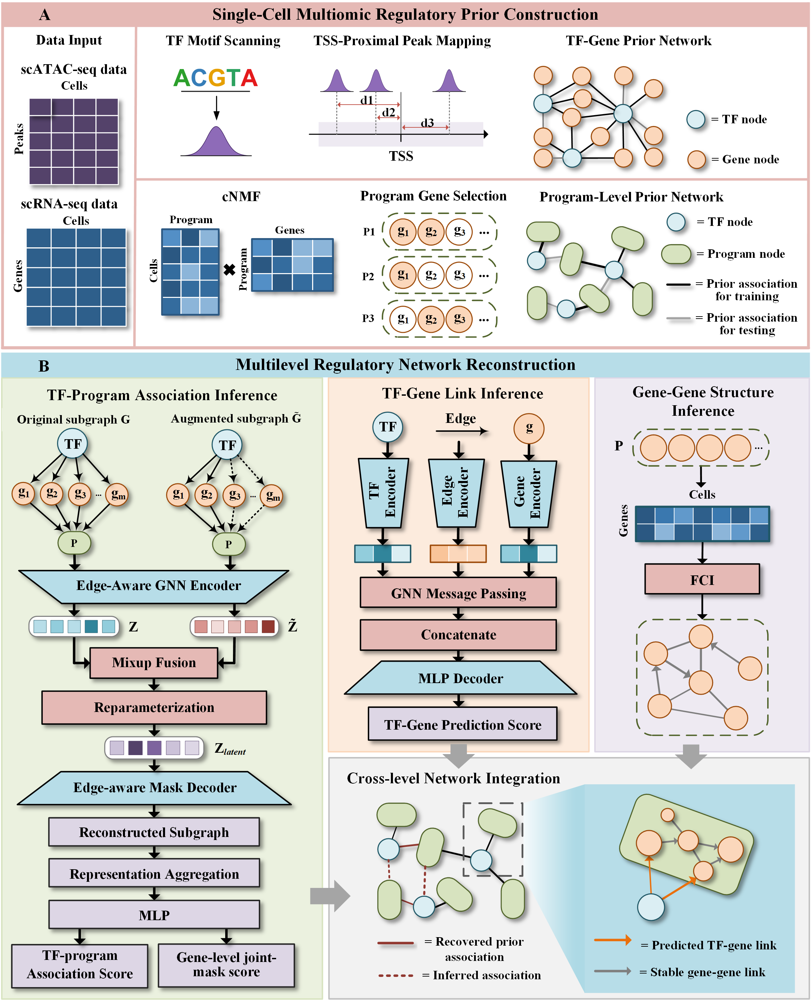

# 🌾 scGRAIN: Multilevel Gene Regulatory Network Inference from Single-Cell Multiomic Data in Rice

> **scGRAIN** is a computational framework for inferring multilevel regulatory networks from single-cell RNA-seq and chromatin accessibility data in rice.

This repository contains the core implementation associated with the manuscript:

**scGRAIN infers multilevel gene regulatory networks from single-cell multiomic data in rice**

---

## Overview

Cell-type-specific transcriptional regulation involves regulatory relationships at multiple levels, including transcription factor (TF)–gene interactions, gene programs, and dependencies among genes.

scGRAIN integrates single-cell transcriptomic and chromatin accessibility information to:

1. infer **TF–program associations** using multiomic graph representation learning and causal subgraph learning;
2. derive **gene-level joint-mask scores** to prioritize program genes contributing to predicted TF–program associations;
3. infer **TF–gene links**; and
4. infer **program-internal gene–gene dependency structures** using Fast Causal Inference (FCI).

---

## Framework overview

<p align="center">
  
</p>

<p align="center">
  <b>Figure 1. Overview of the scGRAIN framework.</b>
</p>

---

## Repository structure

```text
scGRAIN/
├── TF-Program.py
├── TF_Gene.py
├── program50_fci_causal_discovery.py
├── requirements.txt
├── README.md
├── .gitignore
├── data/
│   └── README.md
└── docs/
    └── Fig1.png
```

---

## Installation

Clone the repository:

```bash
git clone https://github.com/SummerY0502/scGRAIN.git
cd scGRAIN
```

Install the required dependencies:

```bash
pip install -r requirements.txt
```

---

## Data

Large input and intermediate files are not stored directly in this GitHub repository because of file-size limits.

See `data/README.md` for the required directory structure.

The expected local organization is:

```text
data/
├── output_top50_bg_centered_Parenchyma_cell/
├── tf_program_ces_top50_bg_centered_cov_fix13/
├── TF_program_result50/
├── RNA/
├── atacRNA/
├── cell_metadata.csv
├── RNA_scRNA_Parenchyma_cell.spectra.k_100.dt_0_5.consensus.txt
├── RNA_scRNA_Parenchyma_cell.usages.k_100.dt_0_5.consensus.txt
└── trans.txt
```
---

## Running the analyses

After placing the required files under `data/`, the three core analyses can be run independently.

### 1. TF–program association inference

```bash
python TF-Program.py
```

Infers TF–program association scores and derives gene-level joint-mask scores for prioritizing program genes.

### 2. TF–gene link inference

```bash
python TF_Gene.py
```

Infers TF–gene link scores and generates binary predictions for candidate TF–gene links.

### 3. Program-internal gene–gene dependency inference

```bash
python program50_fci_causal_discovery.py
```

Infers gene–gene dependency structures among fixed program genes using FCI, with subsampling-based stability analysis.

---

## Citation

If you use scGRAIN in your research, please cite the associated manuscript.

Citation information will be updated upon publication.

---

## Contact

For questions, reproducibility issues, or bug reports, please open an issue in this repository.
